<p align="center">
  <picture>
    <source media="(prefers-color-scheme: dark)" srcset=".github/readme/icon-dark.png">
    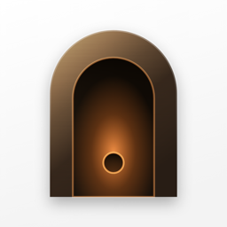
  </picture>
</p>

<h1 align="center">Nostr Vault</h1>

<p align="center">
  Your own Nostr relay, on your own devices.<br>
  <a href="https://nostrvault.app">nostrvault.app</a> · <a href="https://nostrvault.app/docs/">User guide</a> · <a href="https://nostrvault.app/docs/whats-new/">What's new in 3.3.0</a>
</p>

Nostr Vault is a Nostr app that runs your own relay on your own device. Your notes, follows, messages and media are
kept on your phone or computer first, then sent to the relays and media servers you choose. The people you follow
decide who shows up in your feeds, and you decide what reaches each relay.

<p align="center">
  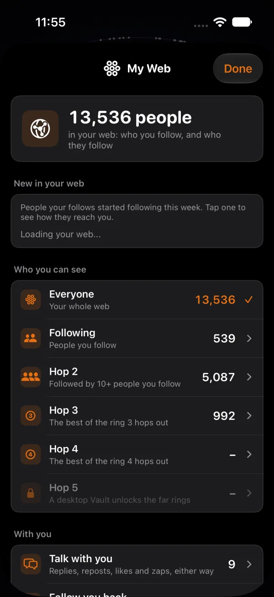
  &nbsp;
  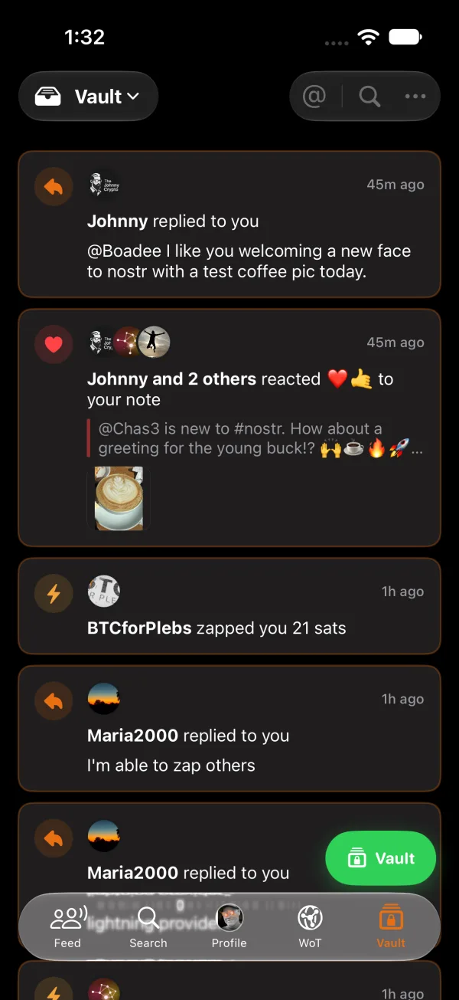
</p>

## Get it

The current release is **3.3.0**.

| Platform | Where | Needs |
|---|---|---|
| iPhone and iPad | [App Store](https://apps.apple.com/us/app/nostr-vault/id6759681282) | iOS / iPadOS 17 or later |
| Mac | [Mac App Store](https://apps.apple.com/us/app/nostr-vault/id6759681282) | macOS 14 (Sonoma) or later |
| Android | [Zapstore](https://zapstore.dev/apps/com.nostrvault.app), or the APK on [GitHub releases](https://github.com/btcforplebs/nostr-vault/releases/latest) | Android 8 or later. Take the APK without `32bit` in its name; if Android says the app isn't compatible (some older budget phones), take the `-32bit.apk` |
| Web | [nostrvault.app/vault](https://nostrvault.app/vault/) | Chrome, Edge, Firefox or Safari 16.4+, nothing to install |
| Linux | [Packages on the v3.3.0 release](https://github.com/btcforplebs/nostr-vault/releases/tag/v3.3.0), steps in [Get started on Linux](https://nostrvault.app/docs/start/linux/) | A 64-bit machine (arm64 or amd64): a Raspberry Pi 4/5, mini PC, home server or desktop |

Nostr Vault for Linux comes as:

- **.deb** for Debian 12+, Ubuntu 22.04+ and Raspberry Pi OS 12 (64-bit)
- **.rpm** for Fedora
- **Arch** package (`.pkg.tar.zst`), for Arch Linux and Arch Linux ARM
- **Alpine** apk for Alpine 3.22+ (OpenRC, no window)
- **Flatpak** for any desktop, such as a Steam Deck (no mesh for now)
- **Nix** flake with a NixOS module: `github:btcforplebs/nostr-vault/v3.3.0`
- **Docker**: the box image `ghcr.io/btcforplebs/nostr-vault-linux`, which the **Umbrel** and **Start9** packages
  run ([linux/README.md](linux/README.md))

On a desktop it has a window and a tray icon. On a box with no screen, you open it from your phone or browser.

## What it does

- **Your own relay.** Every app carries a full Nostr relay (the Go relay from [Haven](https://github.com/bitvora/haven),
  built into the app as a library). Everything you post, receive and save is stored there first. On the web the
  same relay runs in the page as WebAssembly, so your notes stay in your browser, not on a server.
- **Desktop Vaults.** Keep as many Macs and Linux boxes as you like as always-on vaults, each reached over the mesh,
  by web address, or both. Settings › Desktop Vaults shows each one's status and lets you add, move or delete them.
  Your phone stays light, and your full history lives at home.
  ([Desktop Vaults](https://nostrvault.app/docs/mesh/desktop-vaults/))
- **A private mesh between your devices.** Show a code on one device and scan it with the other, and they are linked
  over [FIPS](https://github.com/jmcorgan/fips), an encrypted peer-to-peer mesh. No public IP, port forwarding,
  domain or VPN needed. Your devices sync over it, a new phone can copy your whole vault across, and media can be
  read straight from your own devices. Your devices sign with their own mesh keys, never your account key. The
  protocol is written up in [docs/NIP-F1.md](docs/NIP-F1.md).
- **Web of trust, on by default.** Global feeds, search and notifications are filtered by the follow graph of the
  people you follow, so you see accounts your graph can vouch for instead of the raw firehose. Your web is drawn as
  a globe you can explore, Mute lists sync, and Report and Block are on every post.
- **A trust rank and Hop rings.** Your always-on Desktop Vault reads the follow lists around you in the background and
  ranks everyone up to six hops out from 0 to 100, then hands the result to your phones so they never do the heavy
  work. My Web has rings for Hop 2 through Hop 5: pick one and the globe zooms out to it, and a far hop becomes its
  own spinning sphere. A profile shows how many hops away someone is, and **Why?** shows who links you.
  ([The far rings](https://nostrvault.app/docs/web-of-trust/#far-rings))
- **Your media, kept by you.** Photos and videos go into your own media library and are copied to the
  [Blossom](https://github.com/hzrd149/blossom) media servers you pick. The app runs its own Blossom server too.
  Uploads are smaller by default: photos are brought down to 2048 pixels as JPEG with the camera details and location
  removed, and on iPhone, iPad, Mac and Android videos go up at 720p. Pick **Original** under Upload Quality to send
  files as they are; your Media tab always keeps the originals.
  ([Upload Quality](https://nostrvault.app/docs/media/#upload-quality))
- **htree photos.** Photos with an `htree://` (Iris hashtree) address show and save, up to 2 MiB, in every app.
  ([htree photos](https://nostrvault.app/docs/media/#htree-photos))
- **Keys that never sit in plain text.** Your key is encrypted with NIP-49 and its password kept in the system
  keychain, or kept out of the app entirely with a NIP-46 remote signer (bunker). Sign in by scanning a Nostr
  Connect code with Amber or another signer. Every app refuses to publish a note that contains an nsec.
- **Everything else you expect.** Private messages (NIP-17, with NIP-04 for older apps), zaps through Nostr Wallet
  Connect, threads, articles, live streams, polls, marketplace listings, music and short videos. Notifications are
  made on the device from your own relay, with no push server. Light and dark mode, with an accent colour that the
  app icon follows on iPhone, iPad and Mac.
- **Backups you hold.** Export your notes as JSONL and your media as files, and import them on another device.
  Every version of your follow list, mute list and bookmarks is kept, so a list another app wiped can come back.

<p align="center">
  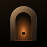
  
  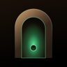
  
  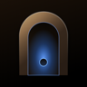
  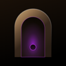
  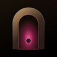
  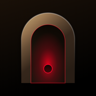
</p>

### On a Mac and on a Linux box

<p align="center">
  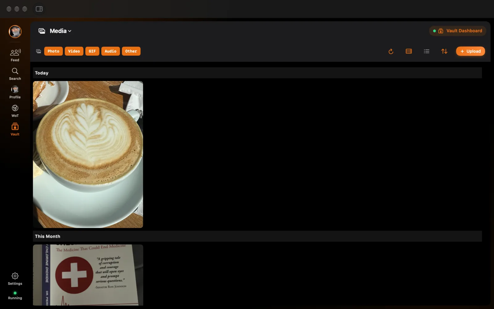
</p>
<p align="center">
  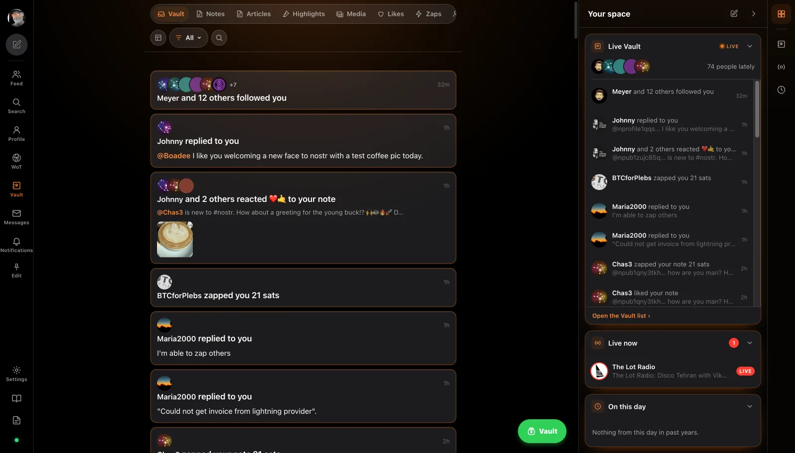
</p>

## Repository layout

| Path | What it is |
|---|---|
| `HavenApp/` | iPhone, iPad and Mac app (SwiftUI). `project.yml` generates the Xcode project |
| `NostrVault/` | Android app (Kotlin, Jetpack Compose) |
| `haven-go/` | The relay, built as a library for every app (fork of [bitvora/haven](https://github.com/bitvora/haven)) |
| `fips-v2/`, `fips-v2-android/`, `fips-bridge/` | The FIPS mesh engine and its bindings (Rust) |
| `web-vault/` | The web app at nostrvault.app/vault |
| `web-relay/`, `web-relay-vault/` | The browser relay and its mesh side |
| `linux/` | The Docker image and installer for a Linux box |
| `website/` | nostrvault.app, including the user guide in `website/docs` |
| `docs/` | Protocol, contract and build notes |

## Build from source

You can build every app yourself and check that what you run is the code you read. The steps below are for macOS,
which the Apple apps need and the Android build script expects.

### Tools

- [Go](https://go.dev/dl/) 1.26 or later
- [Rust](https://rustup.rs) through rustup. The FIPS crates pin their toolchain in `rust-toolchain.toml`, and rustup
  fetches it on the first build
- Xcode 16 or later, for iPhone, iPad and Mac
- For Android: Android Studio with the Android SDK and NDK, JDK 17, and `cargo install cargo-ndk`
- For the web app: Node.js 22 or later
- Optional: [just](https://github.com/casey/just) for the shortcuts in `justfile`, and
  [XcodeGen](https://github.com/yonaskolb/XcodeGen) if you add or move Swift files

```sh
git clone https://github.com/btcforplebs/nostr-vault.git
cd nostr-vault
```

### iPhone, iPad and Mac

```sh
open HavenApp/HavenApp.xcodeproj
```

Pick the `HavenApp-iOS` scheme for iPhone and iPad, or `HavenApp` for the Mac. Choose your own team under Signing &
Capabilities, then run. The build compiles the Go relay and the FIPS engine for you (the `build_haven*.sh` and
`build_fips_*.sh` scripts in `HavenApp/HavenApp/App/`). From the command line: `just ios-build` or `just macos-build`.

The GIF picker needs a nostr.build key. Without one the app still builds and the GIF button is hidden. To add one,
copy `HavenApp/Config/Secrets.xcconfig.example` to `HavenApp/Config/Secrets.xcconfig` (gitignored) and fill it in.

### Android

```sh
just android-build      # Go relay for each ABI, the FIPS engine, then the release APK
just android-install    # install it on a connected device with adb
```

Without a release keystore the APK is unsigned. To sign it, put `KEYSTORE_PATH`, `KEYSTORE_PASSWORD`, `KEY_ALIAS`
and `KEY_PASSWORD` in `NostrVault/local.properties`. Debug and release builds share an app id but not a signing key,
so installing one over the other erases the keys stored on the phone. Use the same kind each time.

The published APKs, 64-bit and 32-bit, are built with
`./scripts/release_all.sh --skip-ios --skip-macos --skip-publish`, which builds everything the release carries.

### Web app

```sh
cd web-vault
npm install
npm run dev       # local dev server
npm test
```

### Linux box

See [linux/README.md](linux/README.md) for the services, the packages (`packaging/`) and the Docker image.
On Nix: `nix build github:btcforplebs/nostr-vault/v3.3.0`, or the NixOS module in `flake.nix` (`nix/`).

## Documentation

- [nostrvault.app/docs](https://nostrvault.app/docs/): the user guide
- [docs/NIP-F1.md](docs/NIP-F1.md): reaching a user's own relay and media over the FIPS mesh
- [CHANGELOG.md](CHANGELOG.md): version history

## Contributing

Issues and pull requests are welcome. Before you change code, read [AGENTS.md](AGENTS.md). It is short and covers
the file size limits, the generated Xcode project, and keeping the Apple and Android apps in step.

## Credits

Built on the relay by [bitvora](https://github.com/bitvora/haven) and the improvements by
[barrydeen](https://github.com/barrydeen/haven). The device mesh is [FIPS](https://github.com/jmcorgan/fips) by
jmcorgan; the apps build from a fork at [btcforplebs/fips](https://github.com/btcforplebs/fips).

3D objects (kind 33331) follow [arkin0x](https://github.com/arkin0x)'s SNO format,
[DECK-0003](https://github.com/arkin0x/cyberspace/blob/master/decks/DECK-0003-sno.md) of the Cyberspace protocol,
including its 256-colour palette. The web vault reads them with his [sno-core](https://github.com/arkin0x/sno-core),
used with his permission (`web-vault/src/vendor/sno-core`).

## License

[MIT](LICENSE)
